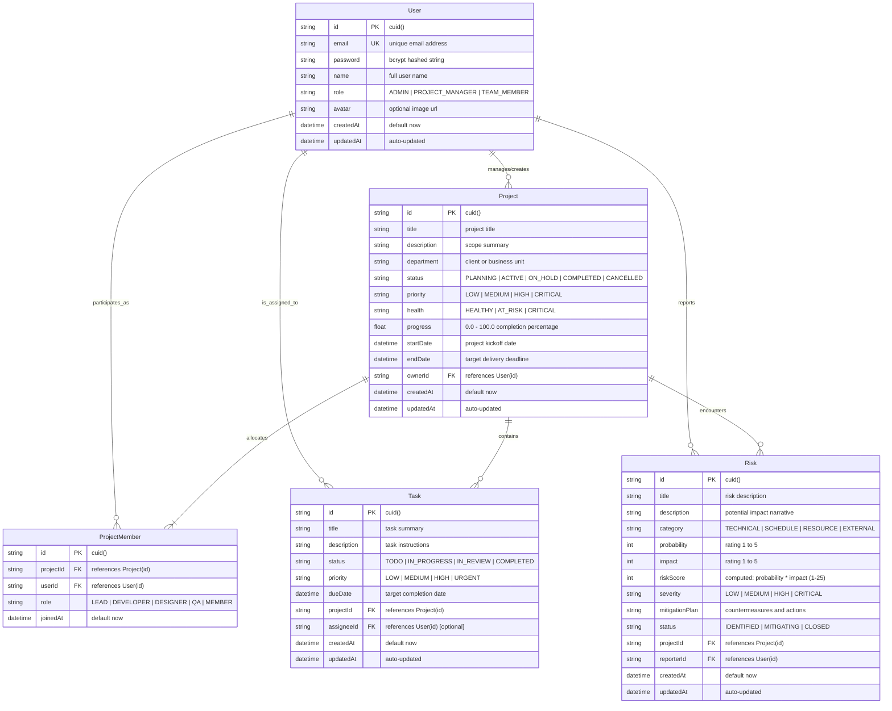

# Entity-Relationship (ER) Diagram

## Project Name: ProjectPulse
### Document Version: 1.0.0

---

## 1. Mermaid Entity-Relationship Diagram

---

## 2. Cardinality & Relational Constraints

1. **User $\rightarrow$ Project (1 to Many):**
   - A User (`PROJECT_MANAGER` or `ADMIN`) can create/manage zero or more Projects.
   - Each Project has exactly one creating owner (`ownerId`).
2. **Project $\rightarrow$ ProjectMember (1 to Many):**
   - A Project contains one or more assigned members.
   - Cascade delete: Removing a project removes all associated membership records.
3. **User $\rightarrow$ ProjectMember (1 to Many):**
   - A User can belong to multiple projects.
   - Unique constraint `(projectId, userId)` prevents duplicate assignments of the same user.
4. **Project $\rightarrow$ Task (1 to Many):**
   - A Project contains zero or more Tasks.
   - Cascade delete: Deleting a project automatically cascades to delete its associated tasks.
5. **Project $\rightarrow$ Risk (1 to Many):**
   - A Project encounters zero or more Risks.
   - Cascade delete: Deleting a project removes its risk register.
6. **Task $\rightarrow$ User (Many to 1, Optional):**
   - A Task can be assigned to at most one User (`assigneeId` is nullable for unassigned backlog tasks).
   - If a User is removed, task references are preserved (`SetNull`).
